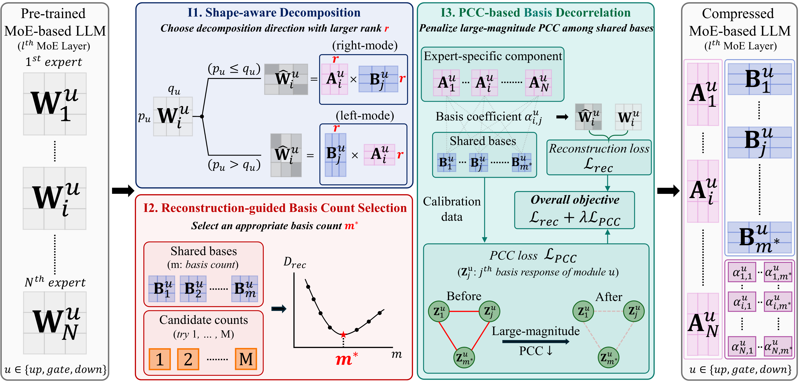

# ACED

This project is a PyTorch implementation of **"ACED: Accurate and Cost-efficient Multi-basis Expert Decomposition for MoE-based LLM Compression"** (EACL 2027 Findings).
This paper proposes ACED, an accurate and cost-efficient multi-basis expert decomposition method for MoE-based LLM compression.

<p align="center">
  
</p>


## Prerequisites

Our implementation is based on PyTorch and Hugging Face `transformers`.

- Python 3.12
- PyTorch 2.7.1
- transformers 4.51.0

We include `requirements.txt`, which contains all the packages used for the experiments except `torch` itself -- install PyTorch separately first, with the CUDA build matching your GPU driver, then install the rest:

```shell
pip install torch==2.7.1 --index-url https://download.pytorch.org/whl/cu126  # pick the CUDA build your driver supports
pip install -r requirements.txt
```

### Before you start

- **Base model**: `--model` supports three MoE architecture families — `mixtral`, `qwen3`, `deepseek` (any checkpoint that shares one of these architectures' expert-weight layout works, not just one specific size). None of the three ship with a path configured: `DEFAULT_BASE_MODELS` in `src/wab_core.py` has all three set to `None`, so `--model {mixtral,qwen3,deepseek}` will raise an error until you either edit that dict with your own local paths, or skip it entirely and pass `--base_model <path>` directly. Either way, the checkpoint must already be downloaded locally (this codebase does not download it for you) — get it with, e.g., `huggingface-cli download <repo_id> --local-dir <path>`.
- **Calibration data**: the I3 stage loads calibration text through the Hugging Face `datasets` library, which downloads it automatically the first time a given `--I3_calib_data_name` is used — this requires internet access to the Hugging Face Hub (or a pre-populated `HF_DATASETS_CACHE`). The accepted values are `wiki2` (WikiText-2, **not** `wikitext2`), `c4` (`allenai/c4`), and `pile` (`mit-han-lab/pile-val-backup` — a maintained mirror, since the original `EleutherAI/pile` is gated/removed from the Hub).

## Usage

Compressing a MoE-based LLM with ACED is a two-stage process, both driven from `src/`. The commands below are exactly what `run_example.sh` runs (compressing Qwen3-30B-A3B end to end). Note: a `#` comment can't follow a `\` line continuation in `sh` without breaking it, so the flags that correspond to a paper symbol (see Table 4 of the paper for the full notation list) are pulled out as variables above the command, commented inline.

First, run `src/aced.py` to search over the base MoE checkpoint: it selects the decomposition direction per module (I1), selects the model-level basis count via a cheap early-reconstruction-error proxy (I2), and records the full configuration — including the I3 calibration/decorrelation settings, if you want them enabled — into an `aced_result.json`.

```shell
TARGET_COMPRESSION_RATIO=0.5   # tau | target compression ratio
FINAL_EPOCHS=3000              # T | number of full optimization steps
I2_NUM_CANDIDATES=8            # K | = |G|, size of the candidate basis-count set
I2_SEARCH_RATIO=0.2            # T_low = I2_SEARCH_RATIO x FINAL_EPOCHS
I2_NUM_SEARCH_LAYERS=5         # H | = |S|, number of sampled layers
I3_LAMBDA_PCC=0.001            # lambda | weight of the PCC loss L_PCC

python src/aced.py \
  --model qwen3 \
  --device cuda \
  --activation tanh \
  --target_compression_ratio "$TARGET_COMPRESSION_RATIO" \
  --final_epochs "$FINAL_EPOCHS" \
  --lr 0.07 \
  --I2_num_candidates "$I2_NUM_CANDIDATES" \
  --I2_search_ratio "$I2_SEARCH_RATIO" \
  --I2_num_search_layers "$I2_NUM_SEARCH_LAYERS" \
  --I3_use_pcc \
  --I3_calib_data_name pile \
  --I3_calib_num_samples 64 \
  --I3_calib_seqlen 512 \
  --I3_lambda_pcc "$I3_LAMBDA_PCC" \
  --I3_tokens_batch 128 \
  --aced_result_path results/qwen3_example/aced_result.json
```

(`--I3_calib_data_name`/`--I3_calib_num_samples`/`--I3_calib_seqlen` together define the calibration dataset `D`, with no individual symbols; every other flag not listed above is an implementation-level setting not named in the paper.)

Second, train the final decomposition and save the compressed model by executing `src/train.py` against that `aced_result.json`. All `I3_*` settings above are carried over automatically; pass any `--I3_*` flag again here to override just that one setting for this run. None of `src/train.py`'s flags correspond to a paper symbol.

```shell
python src/train.py \
  --aced_result_path results/qwen3_example/aced_result.json \
  --device cuda \
  --save_model \
  --save_format both \
  --trust_remote_code
```

`--model {mixtral,qwen3,deepseek}` resolves to whatever local path you configured for it in `DEFAULT_BASE_MODELS`; pass `--base_model <path>` instead to point at any MoE checkpoint directly, without editing that file (see "Before you start" above).

To run with different settings, see the full argument list in `src/aced.py` and `src/train.py`.

### Save formats

`src/train.py --save_model` supports three output modes via `--save_format`:

| `--save_format` | What gets saved | Compatibility |
|---|---|---|
| `wab_native` (default) | Only the compressed per-expert and shared-basis parameters are saved (`models/modeling_{mixtral,qwen3,deepseek}_wab.py`), reconstructing each *routed* expert's weight on the fly during the forward pass. | Custom `trust_remote_code` model class from this repo. |
| `dense` | Each expert's decomposition is expanded back into a full-size dense weight and written into a standard HF checkpoint. | Compatible with any stock `transformers`/vLLM/SGLang pipeline. |
| `both` | Saves both of the above, under `model/` and `model_wab/` respectively. | Both of the above. |

Both save formats are numerically verified to reproduce the same output — `--verify_reconstruction` checks this at save time.

### Code Description

This repository refers to and extends the multi-basis, shared-basis expert decomposition idea introduced by **MoBE (Mixture-of-Basis-Experts)** \[[Github](https://github.com/inclusionAI/MoBE)\].

<!-- Here is an overview of our codes.
ACED/
├── paper/                            # overview figure
├── src/
│   ├── aced.py                       # I1/I2 search entry point
│   ├── train.py                      # final decomposition training + save entry point
│   ├── wab_core.py                   # shared math/grouping helpers
│   ├── weight_io.py                  # checkpoint reading
│   ├── search.py                     # I2 basis-count search helpers
│   ├── wab_train.py                  # training loop + reconstruction
│   ├── calibration.py                # I3 calibration + decorrelation loss
│   ├── model_save.py                 # dense / wab_native save logic
│   ├── utils/data_utils.py           # calibration data loaders
│   └── eval.py                       # PPL / lm-eval-harness evaluation
├── models/                           # WAB-native custom HF model classes
├── results/                          # search + training outputs
├── run_example.sh                    # runnable example of the two-stage pipeline
├── .gitignore
├── README.md
└── requirements.txt

(archive/ also exists locally with older research scripts and the pre-ACED
pipeline, kept for reference only -- it is not tracked in this repository.)
-->

## Reference

If you use this code, please cite the following paper.

```bibtex
@inproceedings{kwon2027aced,
  title     = {{ACED}: Accurate and Cost-efficient Multi-basis Expert Decomposition for {MoE}-based {LLM} Compression},
  author    = {Kwon, Yongmo and
               Kim, Minjun and
               Yang, Hyunwoo and
               Kang, U},
  booktitle = {Findings of the Association for Computational Linguistics: {EACL} 2027},
  year      = {2027}
}
```
